# Interface d'administration

Dans Estompe : **Administration › accès** (droit `acces` de `GET /me` : permission `aegis:admin` ou rôle Keycloak
`AEGIS_ADMIN_ROLE`, sans compte Estompe nécessaire). Chaque appel passe par le relais `/admin/acces/*` d'Estompe vers
`/v1/admin/*` d'aegis, qui reste seul juge. Les comptes y sont toujours désignés par leur e-mail, les serveurs par leur nom.

| Onglet | Contenu |
| --- | --- |
| **Comptes** | Annuaire (recherche par e-mail, nom ou sub, repli sur Keycloak), nombre de rôles, groupes et refus, dernière activité, comptes supprimés de Keycloak. Fiche d'un compte en quatre onglets |
| Fiche › Droits effectifs | Chaque permission active : autorisé, partiel (serveurs autorisés et refusés), refusé ou non défini, avec les règles qui y mènent et leur origine (Tout le monde, rôle, groupe, règle directe, expiration) |
| Fiche › Attributions | Rôles donnés au compte (portée, expiration), groupes, rôles hérités des groupes, règles directes (accorder ou refuser, partout ou sur un serveur, expiration, note), copie des droits d'un autre compte (ajouter ou remplacer, avec aperçu) |
| Fiche › Simulateur | « Ce compte peut-il faire ceci, sur ce serveur ? » : décision et raison |
| Fiche › Historique | Journal filtré sur le compte |
| **Rôles** | « Tout le monde » (ce qui est ouvert à tous), rôle d'administration, rôles libres. Éditeur en grille par application et catégorie : non défini, autorisé ou refusé, exceptions par serveur ; comptes et groupes qui ont le rôle |
| **Groupes** | Membres (avec expiration), rôles du groupe (portée possible), règles du groupe |
| **Catalogue** | Permissions déclarées par chaque application, défaut, type de ressource, règles qui les mentionnent ; purge des obsolètes |
| **Journal** | Toutes les modifications (manifestes, rôles, groupes, droits, expirations), filtrables par action |

Captures faites sur un aegis local alimenté par le vrai manifeste d'Estompe (données de démonstration).

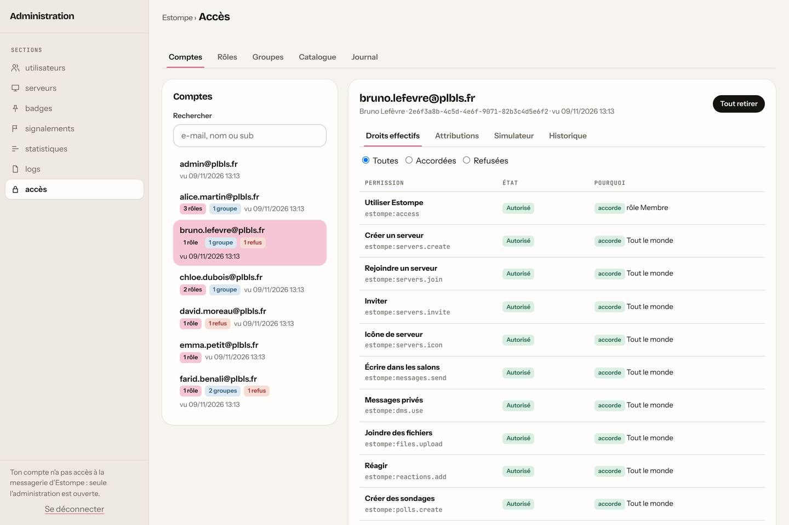
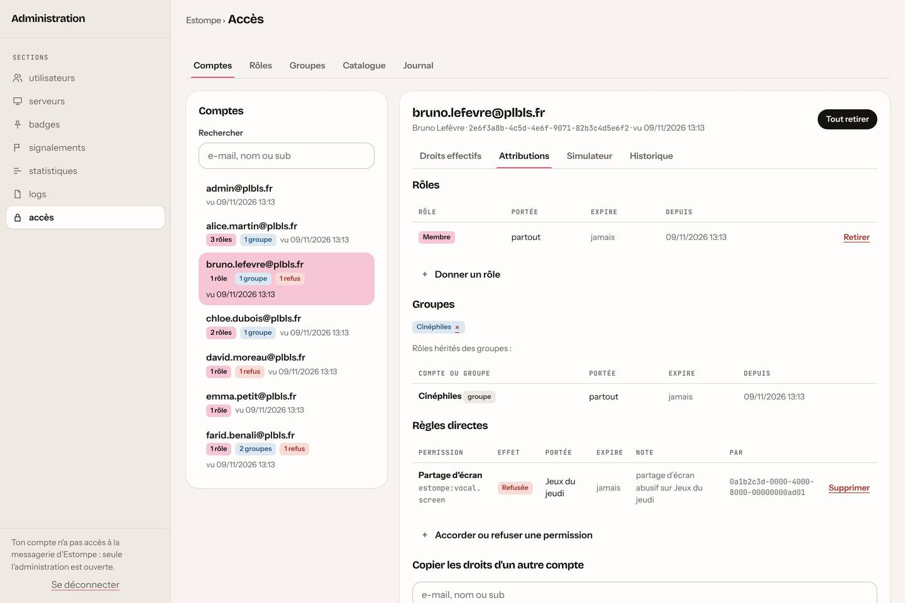
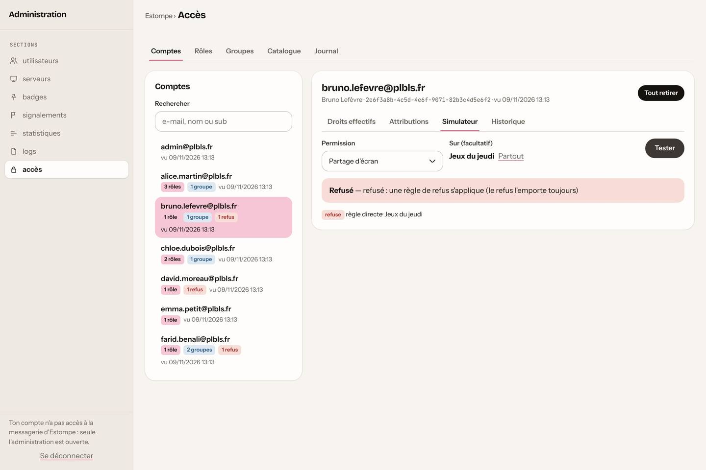
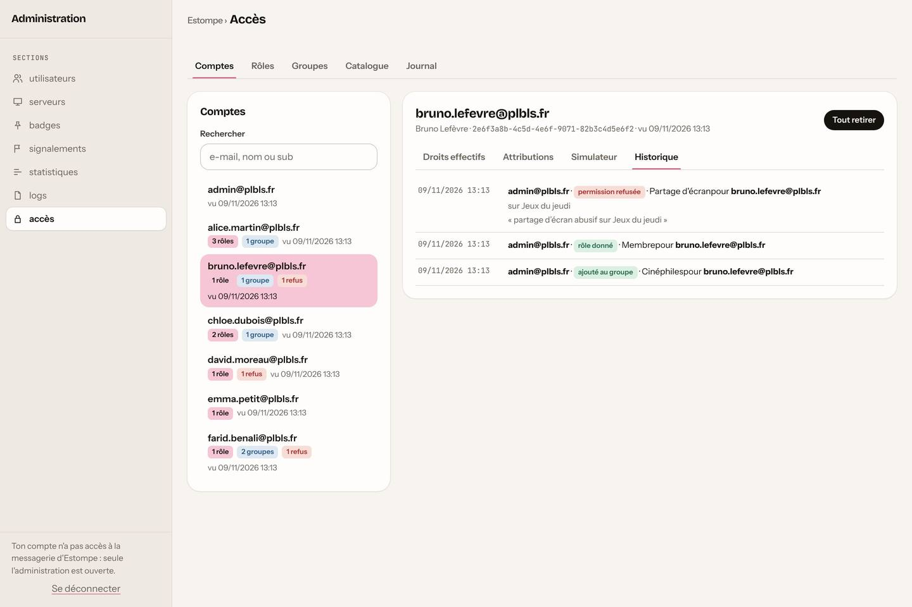
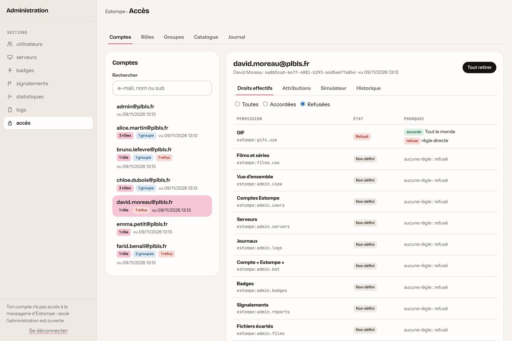
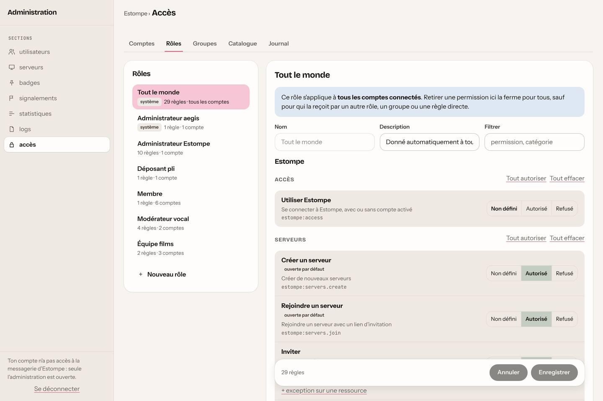
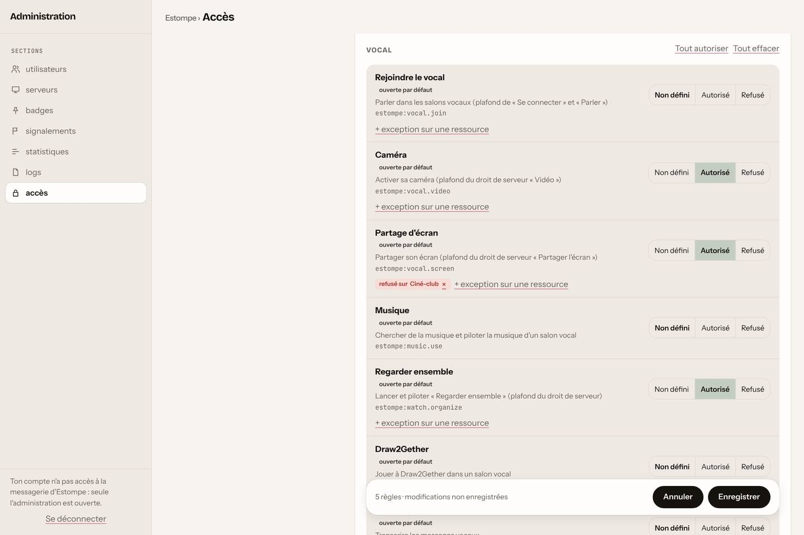
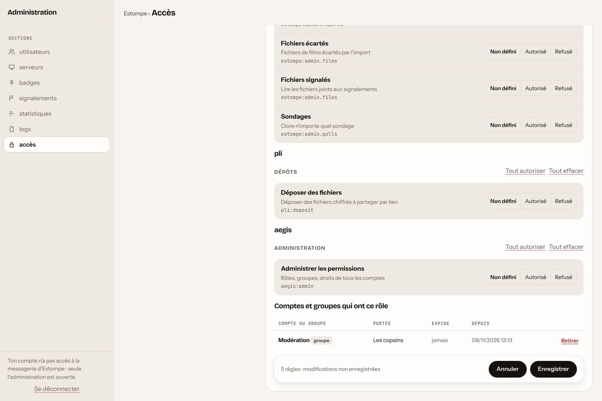
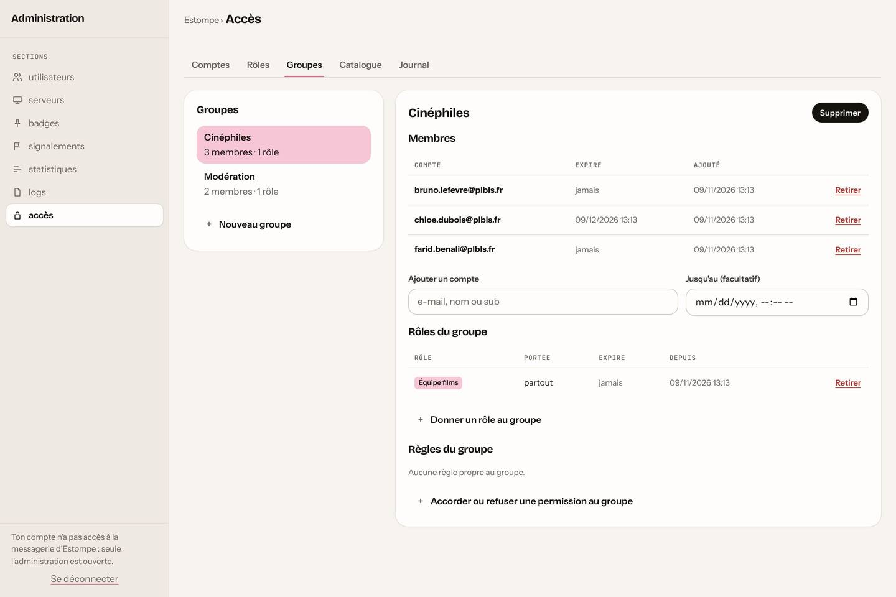
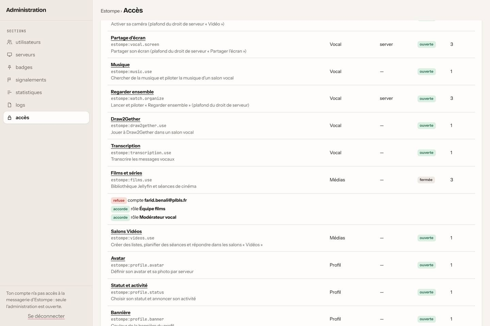
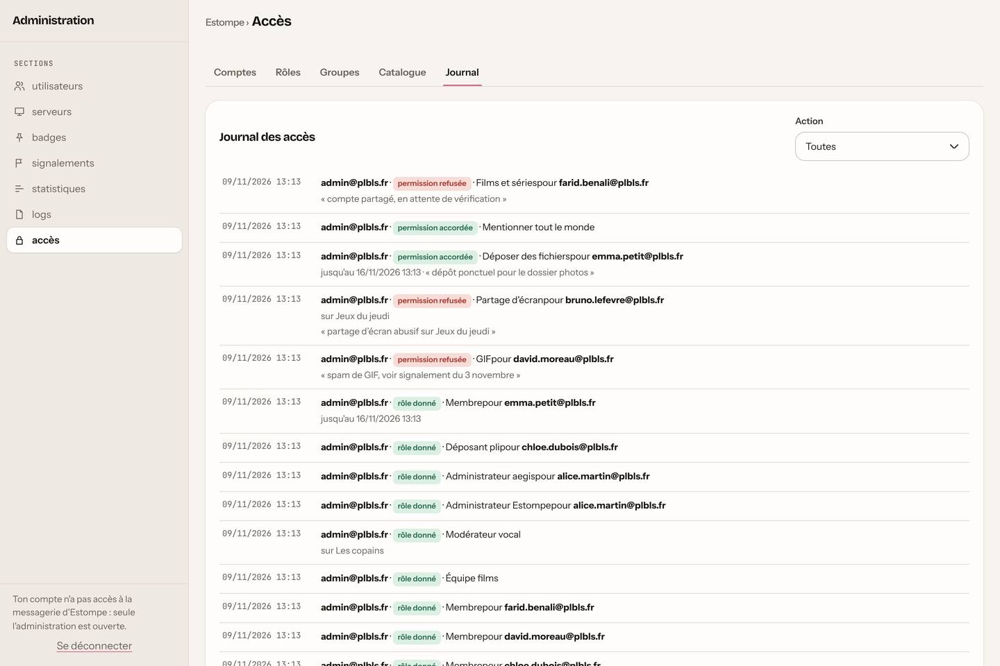
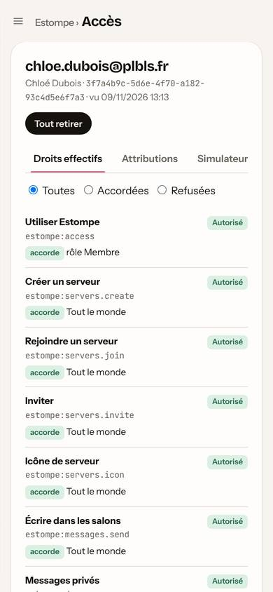

## Ailleurs dans Estompe

- Les sections d'administration existantes suivent chacune leur permission (`estompe:admin.users`, `admin.badges`…).
- L'interface masque ce que le compte n'a pas : bouton GIF, création ou adhésion à un serveur, avatar, Draw2Gether,
  signalement ; les droits de serveur renvoyés par l'API sont déjà plafonnés (partage d'écran, caméra, envoi…).
