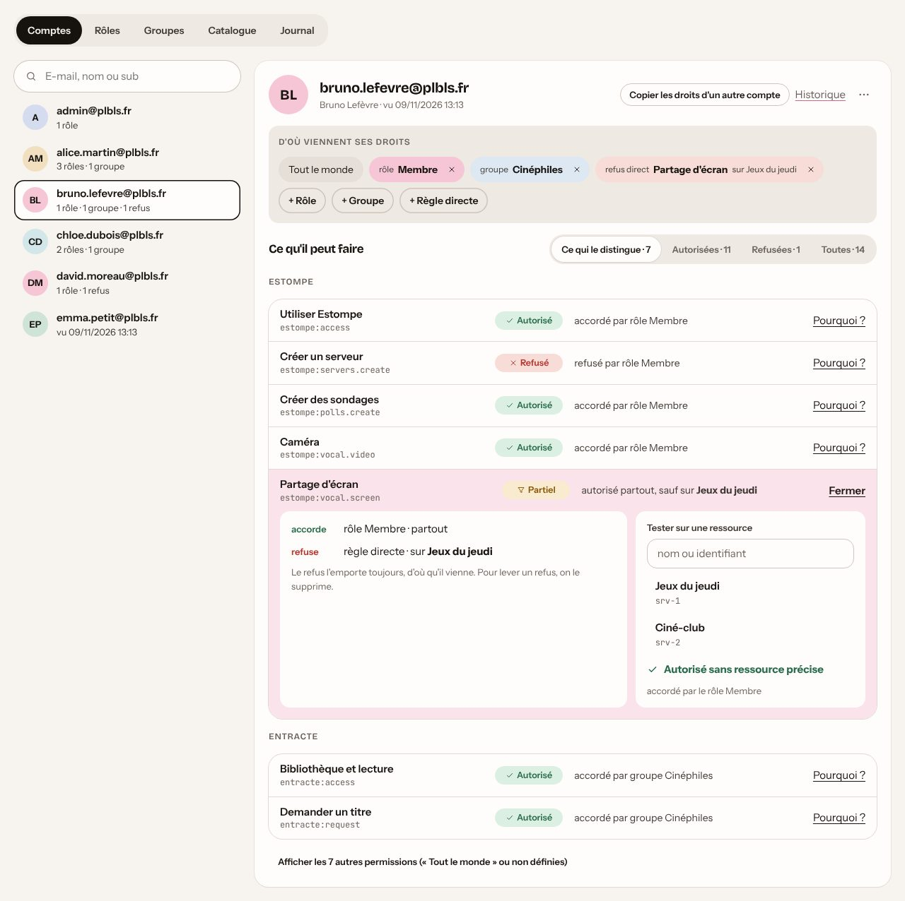
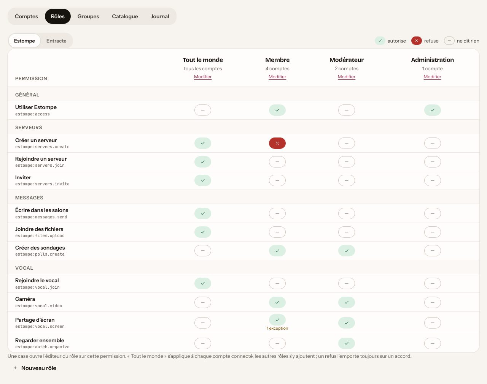
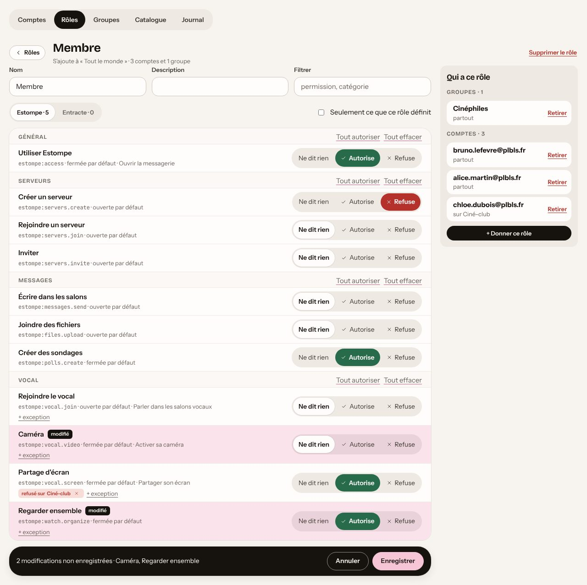
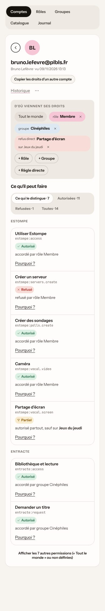

# Interface d'administration

Dans Estompe : **Administration › accès** (droit `acces` de `GET /me` : permission `aegis:admin` ou rôle Keycloak
`AEGIS_ADMIN_ROLE`, sans compte Estompe nécessaire). Chaque appel passe par le relais `/admin/acces/*` d'Estompe vers
`/v1/admin/*` d'aegis, qui reste seul juge. Les comptes y sont toujours désignés par leur e-mail, les serveurs par leur nom.

| Onglet | Contenu |
| --- | --- |
| **Comptes** | Annuaire (recherche par e-mail, nom ou sub, repli sur Keycloak), nombre de rôles, groupes et refus, comptes supprimés de Keycloak. La fiche d'un compte tient en une vue |
| Fiche › D'où viennent ses droits | « Tout le monde », rôles du compte (portée, expiration), groupes, rôles hérités des groupes et règles directes, chacun en puce retirable ; « + Rôle », « + Groupe » et « + Règle directe » ouvrent le formulaire sur place |
| Fiche › Ce qu'il peut faire | Permissions groupées par application : autorisé, partiel (ressources autorisées et refusées), refusé ou non défini, avec l'origine en une ligne. Filtres avec compteurs : « Ce qui le distingue » (par défaut : seules les permissions qu'une règle autre que « Tout le monde » touche), « Autorisées », « Refusées », « Toutes » |
| Fiche › Pourquoi ? | Sur chaque permission : les règles qui mènent à la décision et leur origine, puis la réponse d'aegis (`POST /simulate`), partout ou sur une ressource choisie |
| Fiche › autres actions | « Copier les droits d'un autre compte » (ajouter ou remplacer, avec aperçu), « Historique » (journal filtré sur le compte), et dans le menu « … » : copier l'identifiant, « Tout retirer » |
| **Rôles** | Vue d'ensemble en grille permissions × rôles, par application : chaque case dit si le rôle autorise, refuse ou ne dit rien, et signale les exceptions par ressource ; une case ou un nom de rôle ouvre l'éditeur |
| Rôles › éditeur | Une application à la fois (nombre de permissions définies par application), « Ne dit rien », « Autorise » ou « Refuse » par permission, exceptions par ressource, filtre « Seulement ce que ce rôle définit ». Les lignes modifiées sont surlignées et la barre d'enregistrement nomme les changements. « Qui a ce rôle » (groupes et comptes, retrait, don du rôle à un compte) reste à côté |
| **Groupes** | Membres (avec expiration), rôles du groupe (portée possible), règles du groupe |
| **Catalogue** | Permissions déclarées par chaque application, défaut, type de ressource, règles qui les mentionnent ; purge des obsolètes |
| **Journal** | Toutes les modifications (manifestes, rôles, groupes, droits, expirations), filtrables par action |

Le refus l'emporte toujours ([fonctionnement.md](fonctionnement.md), « Règle de calcul ») : l'interface le rappelle sous chaque explication et sous la grille des rôles.

Captures de la section seule, sur des données simulées (comptes, rôles et serveurs d'exemple).

## Ailleurs dans Estompe

- Les sections d'administration existantes suivent chacune leur permission (`estompe:admin.users`, `admin.badges`…).
- L'interface masque ce que le compte n'a pas : bouton GIF, création ou adhésion à un serveur, avatar, Draw2Gether,
  signalement ; les droits de serveur renvoyés par l'API sont déjà plafonnés (partage d'écran, caméra, envoi…).
