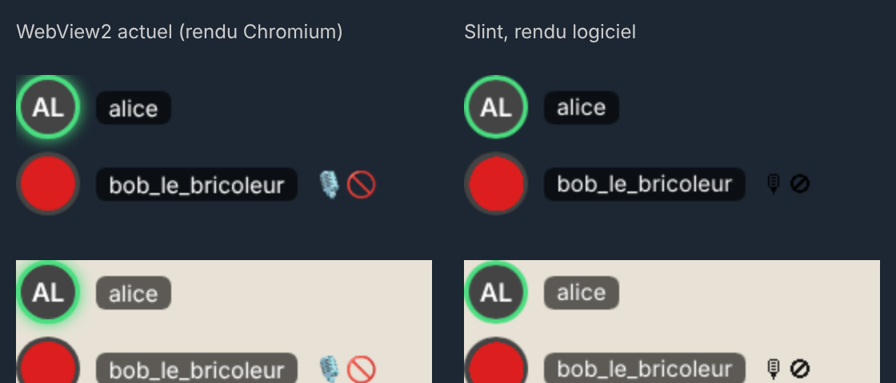

# Overlay natif (Slint) : évaluation

Prototype de l'overlay des participants du vocal sans webview (issue #56). Il est derrière la feature cargo `overlay-natif` de l'app Windows,
désactivée par défaut : les builds publiés ne contiennent ni Slint ni ce code, et la taille de l'installeur ne change pas tant que la feature n'est pas activée.

## Fonctionnement

- `apps/estompe/windows/src-tauri/src/overlay_natif/` : un fil dédié possède une plateforme Slint minimale, avec le moteur de rendu **logiciel**
  (`renderer-software`, polices du système). Ce fil ne crée ni fenêtre winit, ni contexte GPU.
- L'image rendue (RGBA prémultiplié) est affichée par une fenêtre Win32 `WS_EX_LAYERED | WS_EX_TRANSPARENT | WS_EX_TOPMOST | WS_EX_TOOLWINDOW | WS_EX_NOACTIVATE`
  via `UpdateLayeredWindow` : transparence par pixel, jamais de focus, aucun clic capturé, absente de la barre des tâches.
- Le front (`apps/estompe/windows/src/overlay.svelte.ts`) calcule le même état que pour l'overlay webview (participants, taille, coin, écran du jeu).
  Si l'interrupteur « Overlay natif, sans webview (expérimental) » (réglages de l'overlay, visible seulement dans un build avec la feature) est activé,
  il envoie cet état à la commande `overlay_natif_afficher` avec la position et la taille en pixels physiques, au lieu de créer la fenêtre `#overlay`.
- Rendu identique à `Overlay.svelte` : mêmes tailles d'avatar (28, 40, 56 px), contour et halo `#4ade80` du locuteur, pastille du pseudo `rgba(0,0,0,0.6)`, initiales.
  Le moteur logiciel ne découpe pas une image en cercle : l'avatar est donc recadré en disque à son décodage, en Rust.

Construire l'app avec le prototype :

```sh
cd apps/estompe/windows && PATH=../../../node_modules/.bin:$PATH tauri build -- --features overlay-natif
```

## Rendu comparé

Mêmes données, 260 × 96 px, facteur d'échelle 1, sur fond sombre puis clair. À gauche, le balisage et le CSS de `Overlay.svelte` rendus par Chromium ;
à droite, le rendu Slint produit par le test `rendu_transparent_avec_contour_vert_du_locuteur_et_avatar` (`OVERLAY_NATIF_CAPTURE=chemin.png`).
Mesuré sous Linux : 5,1 % de pixels différents (écart > 25 par canal).



Écarts constatés :
- les emoji d'état (micro coupé, casque coupé) sont monochromes : le moteur logiciel ne dessine pas les polices d'emoji en couleur.
  C'est le même écart que L1 dans l'étude ;
- le halo vert du locuteur est un peu plus discret (ombre portée de Slint au lieu de `box-shadow`) ;
- anticrénelage du texte légèrement différent. Sous Windows, les deux utilisent Segoe UI.

## Mémoire, mesure indicative

Sous Linux, médiane de 3 essais, même page et même état :
- page d'overlay seule dans Chromium : **≈ 64 Mo** de PSS pour les deux nouveaux processus de rendu (la page, et vraisemblablement un processus de réserve) ;
- rendu Slint : **≈ 6,9 Mo** de PSS en plus dans le processus, polices du système comprises, après 50 rendus.

Ces chiffres ne remplacent pas la mesure dans l'app Windows (WebView2, jeu réel), qui reste à faire.

## Reste à mesurer pour décider

1. **C1**, coût actuel : 5 sessions du scénario « Partie de jeu avec overlays » de la mesure intégrée (Paramètres › Débogage), interrupteur natif désactivé.
   L'export ne sépare pas les processus de rendu par fenêtre : comparer le total et le type `rendu`.
2. **C3**, gain : 5 sessions identiques avec l'overlay natif. Il tourne dans le processus hôte : comparer le total et le rôle `hote`.
   Puis `node apps/estompe/windows/scripts/synthese-mesures.mjs <exports>`.
3. Comportement en plein écran exclusif et en fenêtré sans bordure, avec un jeu réel. Une fenêtre « layered » n'apparaît pas au-dessus d'un jeu
   en plein écran exclusif DirectX, pas plus qu'une webview.
4. **C4**, décision écrite dans l'issue, chiffres à l'appui. Si l'overlay natif est généralisé :
   - porter de la même façon l'overlay des messages (sans champ de réponse, qui demande une saisie) ;
   - ajouter l'attribution visible exigée par la licence royalty-free de Slint ;
   - mesurer l'effet sur la taille de l'installeur.
